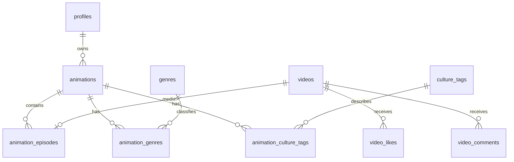

# Animasi, film, dan episode

Model judul/episode ada di migration `20261102000012_animation_titles_and_episodes.sql`.
Publikasi lintas akun dan pembaruan daftar memerlukan tambahan migration
`20261103000013_publication_and_content_realtime.sql`.
Di antarmuka pengguna istilahnya **Animasi**, **Film**, **Serial**, dan **Episode**.

## Model data



`animations` menyimpan metadata satu judul:

| Kolom | Isian |
| --- | --- |
| `id`, `creator_id`, `slug` | Identitas sistem; bukan isian bebas dari client |
| `title`, `synopsis` | Judul maksimal 120 karakter, sinopsis maksimal 2.200 |
| `format` | `film` (satu tayangan utama) atau `series` |
| `poster_path`, `banner_path` | Referensi gambar private; banner opsional |
| `release_year` | Opsional, 1900–2100 |
| `language`, `origin_region` | Bahasa utama dan asal daerah opsional |
| `age_guidance` | `all`, `13+`, `17+`; panduan kreator, bukan sertifikasi resmi |
| `story_status` | `ongoing` atau `completed`, terpisah dari publikasi |
| `status`, `published_at`, `deleted_at` | Dikelola melalui RPC, bukan UPDATE client |

Genre dipilih dari master, maksimal tiga per judul. Genre awal: Petualangan,
Fantasi, Drama, Komedi, Aksi, Misteri, Horor, Edukasi. Tema budaya dipisah dari
genre, maksimal lima: Cerita rakyat, Wayang, Tradisi, Sejarah, Kehidupan Nusantara.
Master hanya bisa diubah oleh administrator database, bukan kreator aplikasi.

`animation_episodes` menghubungkan `video_id` yang unik ke `animation_id`,
`season_number` (1–999), dan `episode_number` (1–99.999). Kombinasi judul, musim,
dan nomor episode unik. Film hanya menerima musim 1, tayangan 1. Media, thumbnail,
judul/deskripsi episode, durasi, like dan komentar tetap memakai ID `videos`.
Reels tetap berupa `videos.content_type = 'reel'` tanpa relasi episode.

`animation_catalog` adalah view dengan `security_invoker = true`: satu baris per
judul terbit yang memiliki tayangan terbit. Jumlah episode, total durasi, dan
video pertama dihitung dari tayangan terbit yang belum dihapus. Urutan awal
berdasarkan nomor musim lalu nomor episode, bukan tanggal upload. Filter durasi
Jelajah memakai **total durasi per judul**, bukan durasi tiap episode.

## Alur Studio

1. **Buat animasi**: simpan judul, format dan metadata sebagai draf. Draf boleh
   dilengkapi bertahap. Upload poster/banner dilakukan sesudah ID tersedia.
2. **Kelola episode / film**: tambah tayangan, isi nomor dan judul episode,
   unggah media, lalu simpan draf atau publikasikan karya. `publish_work`
   menerbitkan tayangan dan judul animasinya dalam satu transaksi. Judul perlu
   sinopsis, poster yang benar-benar ada, dan genre; jika belum lengkap,
   publikasi batal tanpa membuka akses sebagian.
3. **Terbitkan animasi** juga tersedia pada pengelolaan judul yang sudah memiliki
   tayangan terbit. Data lama dengan tayangan terbit tetapi judul masih draf
   ditandai **Belum publik**. Klik **Terbitkan animasi & tayangan** untuk
   menerbitkannya setelah metadata dilengkapi. Migration tidak menerbitkan draf
   lama secara otomatis.
4. Episode draf bisa diatur ulang nomornya atau dipindahkan ke animasi lain
   milik kreator yang sama. Tarik tayangan terbit ke draf sebelum memindahkan.
   Format judul tidak bisa diubah setelah memiliki relasi tayangan.
5. Menarik animasi ke draf atau menghapusnya menyembunyikan semua tayangan dari
   publik tanpa mengganti ID atau menghapus media secara permanen.

Popup membuat animasi tidak mengirim form upload di belakangnya. Draf yang
sudah dibuat tetap terlihat di Studio bila upload poster gagal; retry memakai
ID draf yang sama. Unggahan video tetap memakai workflow cancellation yang ada.
Slot episode dari unggahan yang sudah dihapus dapat dipakai ulang.
Kegagalan transfer Reels maupun animasi sebelum publikasi membersihkan draf milik operasi
tersebut agar nomor episode dapat dicoba ulang. Kegagalan publikasi tetap
mempertahankan media dan draf karena RPC mungkin sudah terkirim.

## Batas otorisasi

Client hanya mendapat SELECT pada tabel animasi dan relasinya. Penulisan melalui:

- `save_animation`: simpan metadata dan relasi genre/tema secara atomik.
- `create_animation_episode`: buat draf media + relasi episode secara atomik.
- `move_animation_episode`: atur relasi draf milik sendiri.
- `set_animation_status`: publish, unpublish, soft delete judul.
- `publish_work`: aksi publikasi aplikasi, memastikan media benar-benar publik.
- `publish_video`: API lama untuk menyiapkan tayangan di bawah judul draf.
- `unpublish_video`, `soft_delete_video`: sembunyikan/hapus media milik sendiri.

RPC memverifikasi akun, kepemilikan, status dan constraint. Relasi episode juga
memiliki trigger integritas; Reels dan media kreator lain tidak dapat dipasang.
Metadata identitas tidak diambil dari payload bebas. Poster baru harus berada
di `{creator_id}/animations/{animation_id}/{filename}` dan objeknya harus ada.
Path media episode lama tetap `{creator_id}/{video_id}/{filename}`.

Read publik episode memerlukan **video terbit + animasi terbit + keduanya belum
dihapus**. Aturan yang sama berlaku pada Storage media/thumbnail, insert like dan
komentar, serta pembacaan interaksi publik. Penulis tetap boleh membaca dan
menghapus interaksinya sendiri. Pemilik tetap dapat mengakses media draf sendiri.
Avatar tetap mengikuti aturan avatar sebelumnya.

URL bertanda tangan yang sudah diterbitkan dapat tetap berfungsi sampai masa
berlakunya habis. Perubahan RLS mencegah penerbitan URL baru; pengujian lokal
tidak membuktikan revokasi cache/URL yang sudah ada di layanan Storage remote.

RPC yang mengembalikan composite row dipanggil dengan `.single()` agar kontrak
client berupa objek, mengikuti [representasi singular PostgREST](https://docs.postgrest.org/en/stable/references/api/resource_representation.html#singular-or-plural).

## Data lama

Migration membuat satu judul `film` per video animasi yang sudah ada. ID judul
awal sama dengan ID video, dengan relasi musim 1 / tayangan 1. ID playback,
Storage, komentar dan like tidak dipindahkan. Status publikasi dipertahankan.
Genre tidak ditebak; metadata yang belum ada dilengkapi kreator. Path thumbnail
lama yang bukan milik kreator/video tidak disalin menjadi poster publik.

Untuk menggabungkan beberapa video lama menjadi serial: buat judul serial,
tarik tayangan ke draf, pindahkan melalui **Atur animasi / nomor**, terbitkan
tayangan melalui **Publikasikan**; serial ikut diterbitkan jika metadatanya lengkap.
Judul film lama yang kosong dapat dihapus.

## Pembaruan lintas browser

Daftar publik memakai computed field `video_is_public`, bukan hanya status video.
Dengan begitu, akses Studio milik kreator tidak membuat katalog pribadinya
menampilkan tayangan yang sebenarnya belum dapat ditonton akun lain.

Migration 13 menambahkan `public_content_revision`: satu baris berisi nomor revisi
dan waktu perubahan, dengan SELECT untuk anon/authenticated dan tanpa hak tulis
client. Trigger menaikkan revisi saat konten publik berubah, termasuk unpublish
atau penghapusan. Perubahan draf privat tidak menyiarkan revisi publik. Publication
`supabase_realtime` hanya mendapat tabel revisi ini dari migration tersebut;
baris video, judul, path, atau identitas kreator tidak disiarkan oleh mekanisme ini.

Client berlangganan perubahan revisi, menggabungkan notifikasi berdekatan, lalu
membaca ulang data melalui RLS. Polling revisi tiap 30 detik, reconnect, kembali
ke tab, dan event online membantu pemulihan bila WebSocket terputus. Filter,
halaman, teks popup yang belum disimpan, dan player aktif dipertahankan ketika
daftar berubah. Tayangan yang sudah tidak publik dikeluarkan dari player setelah
verifikasi ulang; signed URL lama tetap mengikuti masa berlaku Storage.

Kontrak mengikuti [computed fields PostgREST](https://docs.postgrest.org/en/latest/references/api/computed_fields.html)
dan [Postgres Changes Supabase](https://supabase.com/docs/guides/realtime/postgres-changes).

## Penerapan Supabase

Migration 13 **belum diterapkan ke project remote oleh agent**. Workspace tidak
memiliki CLI/link project atau koneksi administrator Supabase yang tersedia
saat pengerjaan. Pengujian SQL dilakukan pada database PostgreSQL terisolasi.

1. Cocokkan schema/project tujuan dan migration yang benar-benar sudah terpasang.
   Migration 12 membutuhkan migration 1–11. Jangan menganggap schema remote sama
   dengan file repo atau menjalankan ulang seluruh migration pada database lama.
2. Setelah dependensi terverifikasi, jalankan file migration 12 utuh melalui
   Supabase SQL Editor sebagai administrator. File dibungkus transaksi; kegagalan
   harus di-rollback, bukan dilanjutkan sebagian. Jika memakai CLI yang sudah
   terhubung, review migration pending dan target project sebelum menerapkannya.
3. Jalankan migration 13 utuh setelah migration 12 berhasil. Untuk instalasi yang
   sudah memiliki migration 12, jangan jalankan ulang file 12. Verifikasi fungsi
   `publish_work(uuid)`, `video_is_public(public.videos)`, tabel
   `public_content_revision`, serta keanggotaan tabel tersebut di publication
   `supabase_realtime` sebelum menyalakan client baru.
4. Deploy client yang cocok setelah schema baru siap. Frontend baru sengaja
   tidak kembali ke katalog video datar jika schema baru belum tersedia.
5. Periksa hasil backfill: jumlah judul film hasil migrasi sesuai video animasi
   lama; episode dan URL lama masih ada; Reels tidak mendapat relasi episode.
6. Verifikasi remote dengan akun uji khusus: kreator A dan B, anonymous, media
   draf/terbit, publish/unpublish judul, genre, upload, pembatalan, dan signed URL.
   Jangan memakai akun pribadi utama atau mengirim password/service key di chat.

Perubahan ini tidak menambahkan fitur follow, billing, atau subscription backend.

## Verifikasi lokal

```text
npm.cmd run test:types:modal
npm.cmd test
npm.cmd run test:security:db
npm.cmd run test:ui
```

Suite database mengeksekusi seluruh migration pada PostgreSQL PGlite, menyiapkan
fixture sebelum migration 12, lalu memeriksa backfill, grant, RLS dan RPC dengan
dua identitas. Suite browser memakai API/media mock untuk menguji form, retry,
publikasi, relasi, katalog dan navigasi episode. Keduanya melengkapi satu sama
lain dan tidak menggantikan verifikasi project Supabase remote.
